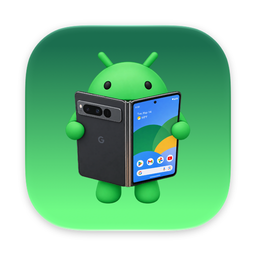

<p align="center"></p>
<div align="center"><b>AVDs</b>. An AVD Manager for the MacOS menu bar.</div>
<div align="center">Launches Android emulators and mirrors connected Android phones.</div>

<br>
<br>

<p align="center"></p>

## Install

1. Download `AVDs-<version>.dmg` from the [latest release](https://github.com/floschu/AVDs/releases/latest) and open it.
2. Drag AVDs onto Applications.
3. The app isn't signed or notarized, so macOS blocks it on the first launch with "Apple could not verify AVDs". Open System Settings, Privacy & Security, scroll down and click Open Anyway. Or run this once in Terminal: `xattr -dr com.apple.quarantine /Applications/AVDs.app`

AVDs needs macOS 26 on Apple silicon, the [`android` CLI](https://developer.android.com/tools/agents/android-cli) and the Android SDK. To mirror devices, install [scrcpy](https://github.com/Genymobile/scrcpy) with `brew install scrcpy`. If something is missing, AVDs lists it with the command to install it.

macOS asks whether AVDs may find devices on your local network. That's adb looking for devices with wireless debugging. If you deny it, emulators and USB devices still work.

## Build

```
scripts/build.sh            # builds app/build/AVDs.app
scripts/build.sh --install  # also copies it to /Applications and restarts it
scripts/record-demo.sh      # re-records the animation above, and an MP4 for posts, after UI changes
```

## Release

```
scripts/release.sh 1.1.0
```

The script bumps the version code, builds, commits, tags `v1.1.0`, pushes and creates the GitHub release with a DMG of the app.
Your working tree has to be clean and `gh` logged in. `scripts/release.sh 1.1.0 --dry-run` only builds the DMG.

## Author

Visit my [website](https://flosch.at/).
